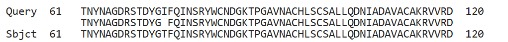

### Align WT and mutant protein in BLAST using wild type as a base:

Single amino acid change: p.Ile74Thr (position 74, I → T; Substitution / missense)
Amino acid position: 74
Amino acid change: Ile → Thr (I → T)
